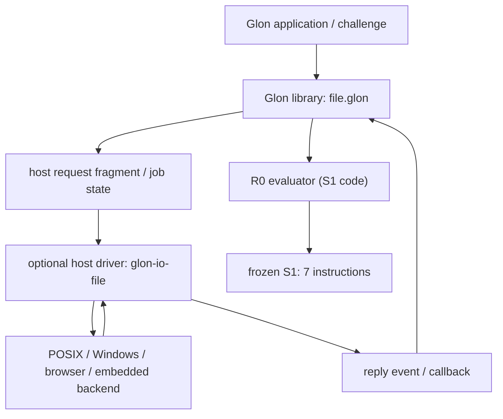
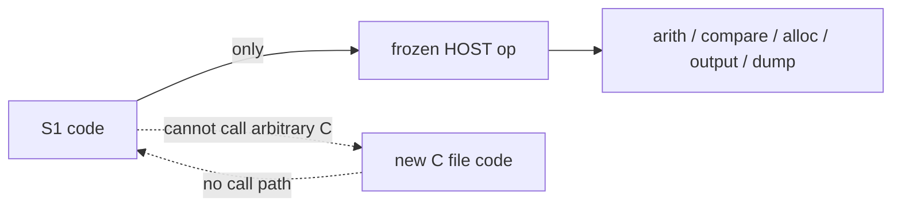
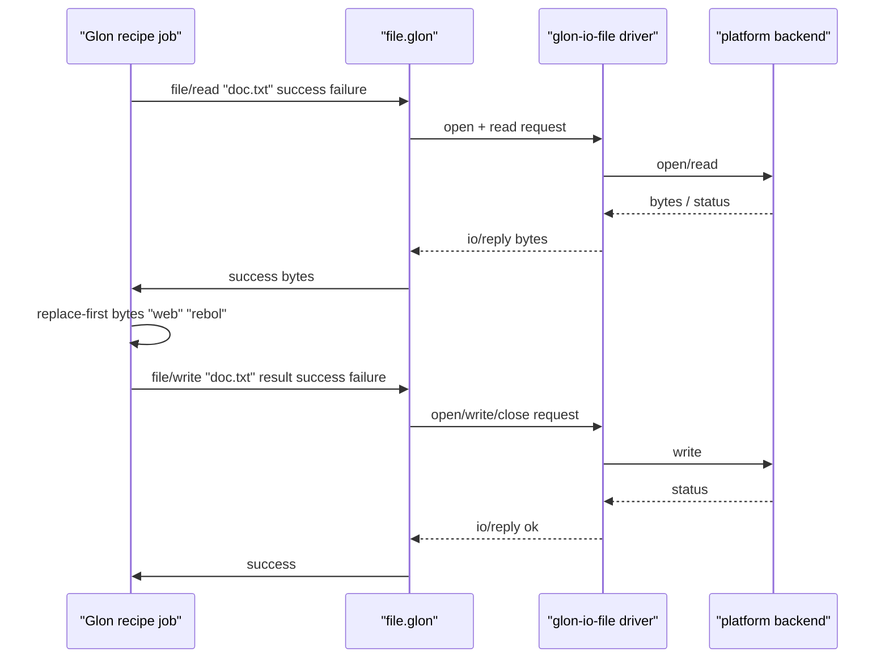
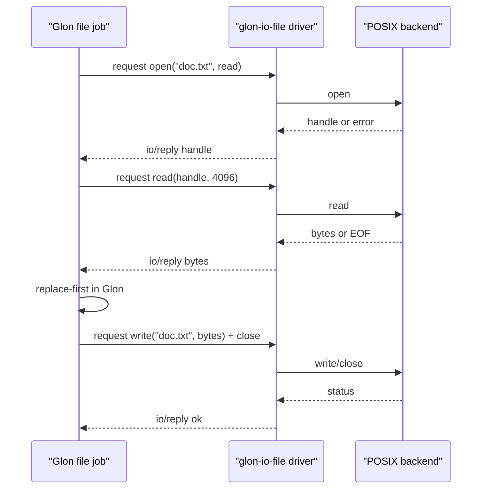

# Glon Optional Portable File I/O — `glon-io-file` Design Proposal

**Status:** design, revision 2. A POSIX native proof of concept now exists;
see `GLON-OPTIONAL-IO-IMPLEMENTATION.md`,
`GLON-OPTIONAL-IO-STABILISATION.md` and `GLON-OPTIONAL-IO-STREAMING.md`. The Windows/WASM/embedded backends in
this document remain unimplemented.
**Base:** `glon-shop-g1a` at `89de40e737b022a0d987093bb6c5b1e8d1a8a83e`.
**Revision 2:** adds the blocking-versus-asynchronous feasibility study in §12
and the revised recommendation in §12.7.
**Scope:** an optional, compile-time file-I/O module for the native CLI,
native applications and WebAssembly hosts.

This proposal does not modify `s1.c`, `s1.h`, `tests.c`, `adversarial.c`,
`claims.c`, the parser, the evaluator, the grammar, the prelude, existing
applications or the published language semantics.

Labels used below:

- **[EXISTING]** implemented and tested in the pinned engineering repository;
- **[PROPOSAL]** proposed by this document, not implemented;
- **[REJECTED]** considered and rejected under the current invariants;
- **[DECISION REQUIRED]** needs approval before implementation.

---

## 1. Executive summary

Glon's frozen substrate exposes only seven instructions:

```text
LIT DUP DROP @ ! 0BRANCH HOST
```

The `HOST` instruction has a fixed set of arithmetic, comparison, allocation,
output and diagnostic operations. It has no file operation, no input operation
and no generic "call a C function" operation.

The current native `glon` CLI treats its arguments as Glon **source files**. It
loads those files into one persistent session and prints the result of each.
There is no program-visible file read/write interface.

The browser/WASM ABI similarly has only print/text/HTML/Canvas and the
experimental GLON_LIVE host-call path. The desktop proof has a filesystem read
request/reply path, but no general file-write binding.

**Consequence:** a conventional blocking `file/read` or `file/write` word
cannot be added to ordinary Glon evaluation by compiling a new C file alone.
The evaluator is S1 code and can call only the frozen `HOST` operations. Adding
a synchronous file host operation would require changing the frozen substrate
or introducing an undocumented host side channel.

**Recommendation:** implement `glon-io-file` as an optional **host-driven
module plus an ordinary Glon state-machine library**, using an explicit
request/reply protocol. The host moves bytes and owns file handles; the Glon
library performs replacement and application logic. This preserves all frozen
and evaluator invariants.

The cost is that phase 1 is **event-driven**, not a blocking four-line
program. A later synchronous API would require a separate, explicit substrate
decision.

---

## 2. Existing architecture and reusable mechanisms

### 2.1 Layers



The optional module lives at the **host and Glon-library boundary**, not in
S1 and not in the evaluator.

### 2.2 What exists today

| Mechanism | Status | Relevant facts |
|---|---|---|
| S1 `HOST` | [EXISTING] | IDs are `HOST_ADD` through `HOST_DUMP`; no file or input operation (`s1.h:42-48`, `s1.c:134-160`). |
| R0 evaluator | [EXISTING] | Emitted S1; no file native. Native IDs cover arithmetic, `print`, `values`, `either`, `do`, `invoke`, `reduce` and SIN! only. |
| Native `glon` CLI | [EXISTING] | `glon FILE...`; arguments are source files. It loads `glon-lib/prelude.glon` and `glon-lib/strings.glon` (`glon.c:104-198`; `Makefile:293-300`). |
| WASM ABI | [EXISTING] | Byte-oriented exports and host imports for text/HTML/Canvas. No filesystem import. See `GLON-WASM-ABI.md`. |
| GLON_LIVE | [EXISTING, EXPERIMENTAL] | Outbound request fragment `0x01 op 0x00 arg` followed by `host_call`; inbound `glon_event_bytes` binds `current-value` as a managed STRING! (`r0_s1_g1a_live.c:79-177`). |
| Desktop FS read | [EXISTING, HOST-SPECIFIC] | `fs-read` request/reply and `serve-file` data plane (`desktop/glon_desktop.c:352-389`). Path authority stays in Glon (`desktop/app.glon`). |
| Desktop FS write | [EXISTING, BROKERED ONLY] | Fetch service writes download targets after host checks `file/app-write`; no general Glon file-write word. |
| STRING!/string ops | [EXISTING] | Immutable byte sequences, `mk-string`, `s/+`, `s/=`, `s/length`, optional `strings-ext` (`s/slice`, `s/span`, `s/at`, `s/scan-set`, `s/from-int`). One byte per cell in the managed heap. |
| SIN!/raise/judge | [EXISTING] | Recoverable failures are Glon values; `raise` unwinds to `judge`. Machine fail-stops are not catchable. |
| M1 tasks | [EXISTING] | Cooperative task records and scheduler; no host pre-emption. |

### 2.3 Reusable pieces

- The persistent source/session loader and the `glon` CLI.
- The GLON_LIVE request-fragment/event-bytes pattern as a **protocol model**.
- The host C buffers and table style used by `r0_s1_g1a_live.c`.
- `mk-string`/`s/+` for building managed byte strings from reply bytes.
- `SIN!`/`raise`/`judge` for recoverable I/O results delivered as data.
- The desktop host's distinction between **logical resource names in Glon**
  and **bytes/paths moved by the host**.
- M1 task records for cooperative scheduling, if I/O waits are integrated with
  tasks.

### 2.4 What cannot be reused

- `HOST` cannot be extended: `s1.c`/`s1.h` are frozen, and `HOST` has no
  generic callback or input operation.
- The native `glon` CLI has no event loop for host requests and no
  asynchronous reply channel.
- GLON_LIVE is dispatch-scoped (`route`/`do-event`) and experimental; it is
  not a general native file API.
- The desktop `fs-read` path has no general write contract and is tied to one
  host application.
- Writing replies into Glon memory from inside `host_print` was previously
  rejected as an undocumented side channel. This proposal does not revive it.

### 2.5 The hard boundary



A new C file linked into `glon` is not reachable from ordinary Glon
evaluation unless a host operation or an external driver invokes Glon and
exchanges data with it. The module therefore must be **host-mediated**.

---

## 3. Proposed module boundary and build configuration

### 3.1 Module name and layers

Provisional name: **`glon-io-file`**.

| Layer | Responsibility | Where |
|---|---|---|
| **Glon library** | Request construction, job state machine, whole-file read/write helpers, replacement policy, SIN! mapping | `glon-lib/file.glon` (optional) |
| **Host driver module** | Accept requests, enforce capability/path policy, call platform backend, return replies | `glon_io_file.c` + CLI/WASM driver integration |
| **Platform backend** | POSIX/Windows/WASM/embedded byte I/O; no application semantics | `glon_io_file_posix.c`, `_win32.c`, `_wasm.c`, `_null.c` |
| **Protocol** | Framing, request IDs, status codes, handle tokens | `glon_io_file.h` |

The host module is not a general plugin framework. Module selection is
compile-time only; there is no `dlopen`, dynamic plugin discovery or runtime
module registration.

### 3.2 Build interface

The existing Makefile defines `GLON_SRCS` and the `glon` target at
`Makefile:293-300`. The proposed change is a module list, not a new build
system:

```make
MODULES ?=
GLON_MODULE_SRCS :=
GLON_MODULE_CFLAGS :=
GLON_MODULE_LIBS :=

ifeq ($(filter file,$(MODULES)),file)
  GLON_MODULE_SRCS += glon_io_file.c glon_io_file_cli.c
  GLON_MODULE_CFLAGS += -DGLON_MODULE_FILE
  GLON_MODULE_LIBS += glon-lib/file.glon
endif

glon: $(GLON_SRCS) $(GLON_MODULE_SRCS) r0_s1.h s1.h m1_layout.h \
      $(GLON_LIBS) $(GLON_MODULE_LIBS)
	$(CC) $(CFLAGS) $(GLON_MODULE_CFLAGS) -I. -o $@ \
	      $(GLON_SRCS) $(GLON_MODULE_SRCS)

glon-lib/file.glon: modules/file.glon
	@mkdir -p glon-lib
	cp $< $@
```

Then:

```sh
make glon                    # minimal build, byte-for-byte current behavior
make glon MODULES=file       # optional host module + file.glon staged
```

Unknown module names must fail at build time. `MODULES=` (empty) is the
minimal build. The module does not change the language's global vocabulary
unless `file.glon` is loaded.

**Acceptance requirement:** the minimal `glon` binary must not contain the
module object code, symbols, strings or library. This is checked in CI with
`nm`/`size` and a binary/string comparison, not merely by conditional source.

### 3.3 Runtime capability permissions

Compiling the module **does not grant filesystem access**. The host driver
explicitly grants scopes:

```text
--io-root DIR              root containing all accessible files
--allow-file-read          permit read-only access under the root
--allow-file-write         permit write access under the root
--io-max-handles N         optional small bound
--io-max-file BYTES        whole-file convenience limit
```

Default is deny-all. The module should reuse the capability vocabulary in
`GLON-HOST-CAPABILITIES.md`:

- `file/app-read`
- `file/app-write`

At the application-host level, permissions come from an application manifest
and a host grant store; a module build is still not an authority grant. The
challenge/test driver should use a temporary root with explicit read/write for
that root only.

### 3.4 Distinguishing the four concerns

| Concern | Example |
|---|---|
| Compiled host functionality | POSIX `open/read/write/close`; Windows `CreateFileW`; browser host API |
| Glon-level vocabulary | `file/read`, `file/write`, `io/open`, `io/read` |
| Runtime capability permission | `file/app-read`, `file/app-write`, `--io-root` |
| Platform-specific implementation | POSIX vs Win32 vs WASM vs embedded VFS |

---

## 4. Portable I/O contract

### 4.1 Why phase 1 is job/event based

A blocking `file/read path -> bytes` would have to suspend the S1 evaluator
inside a `HOST` operation. That is not available in the frozen substrate.
Adding it requires a substrate change (see §7.1).

The proposed portable contract therefore has two parts:

1. a **host handle service** that performs open/read/write/close;
2. an **ordinary Glon job API** that issues requests and consumes replies.

The replacement algorithm and all application policy remain in Glon.

### 4.2 Host service operations

The compiled host exposes these operations to its driver, not as Glon words:

```c
typedef enum {
    GLON_IO_OK = 0,
    GLON_IO_EOF,
    GLON_IO_NOT_FOUND,
    GLON_IO_PERMISSION,
    GLON_IO_INVALID_HANDLE,
    GLON_IO_TOO_LARGE,
    GLON_IO_IO_ERROR,
    GLON_IO_UNSUPPORTED,
    GLON_IO_BUSY
} glon_io_status;

typedef struct { uint32_t value, generation; } glon_io_handle;

glon_io_status glon_io_open(const glon_io_policy *policy,
                            const uint8_t *name, size_t name_len,
                            glon_io_mode mode,
                            glon_io_handle *out,
                            glon_io_error *err);

glon_io_status glon_io_read(glon_io_handle h,
                            uint8_t *buf, size_t cap, size_t *read,
                            glon_io_error *err);

glon_io_status glon_io_write(glon_io_handle h,
                             const uint8_t *buf, size_t n, size_t *written,
                             glon_io_error *err);

glon_io_status glon_io_close(glon_io_handle h, glon_io_error *err);
```

Minimum modes: `READ`, `WRITE`, `READ_WRITE`. Phase 1 may implement only
whole-file read/write convenience and no seek. No seek, truncate or metadata
operation is required for Recipe 0004.

The host service is **not called directly from the S1 evaluator**. It is called
by the module's driver after receiving a request from Glon.

### 4.3 Request/reply protocol

The protocol is binary and length-prefixed. It may use the existing request
fragment shape for transport, but must not use a NUL separator for binary file
data.

```text
request  = magic:u8=0x01, op:u8, request_id:u32,
           field_count:u8, field*
field    = length:u32, bytes[length]

reply    = magic:u8=0x81, request_id:u32, status:u8,
           field_count:u8, field*
```

Operations:

| op | request fields | success reply fields |
|---|---|---|
| `open` | name, mode | handle, generation |
| `read` | handle, max_bytes | bytes |
| `write` | handle, bytes, length | bytes_written |
| `close` | handle | none |
| `stat` (optional) | name | size, readable, writable |

`read` returns at most `max_bytes`; a zero-length success is EOF. A short
read/write is a normal result, not an error. The Glon library loops until EOF
or until all bytes are written. A zero-byte write with remaining data is
`IO_IO_ERROR` (prevents an infinite loop).

Request IDs are opaque, per-session integers. A reply with an unknown or stale
request ID is a protocol/machine failure, not a recoverable SIN!.

### 4.4 Glon-facing API — phase 1

Phase 1 uses **one outstanding I/O request per task** and explicit success/
failure closures. This avoids a hidden global handle table in Glon and makes
the host-driven model visible.

```glon
;; Whole-file conveniences, built in Glon over the handle jobs.
file/read:  func [name success failure]                  ;; request
file/write: func [name bytes success failure]            ;; request

;; Low-level handle jobs.
io/open:    func [name mode success failure]             ;; request -> handle
io/read:    func [handle max success failure]            ;; request -> bytes
io/write:   func [handle bytes success failure]          ;; request -> written
io/close:   func [handle success failure]                ;; request -> none

;; Host driver entry: feed one reply back into the pending job.
io/reply:   func [request_id status bytes]               ;; host calls this
```

Semantics:

- `file/read name success failure` requests the whole file; on success it
  calls `success bytes`; on error it calls `failure sin`.
- `file/write name bytes success failure` writes/truncates the file; success
  receives no value.
- `io/open name mode success failure` passes a handle to `success`; the mode is
  one of the words `'read`, `'write`, `'read-write`.
- `io/read` calls `success bytes` with `0..max` bytes. `success` decides
  whether to issue another read. The library provides `file/read-all` as a
  ready-made loop.
- `io/write` calls `success written`; `file/write-all` loops over short writes.
- `io/close` closes the handle; failure is `SIN! 'io 'close`.
- Only one outstanding request per task in phase 1. A second request while one
  is pending raises `SIN! 'io 'busy`. Phase 2 may generalize to a pending map.

The callbacks are ordinary Glon closures. The host driver must not retain
raw Glon values across GC without rooting them; the library's pending state is
a managed closure/value. The host invokes `io/reply` as an ordinary Glon entry
with the reply fields.

A whole-file convenience may have a host-configured limit (`--io-max-file`,
proposed default 4096 bytes) because a file is represented as one managed
STRING! and the managed heap is only 7,232 cells. Larger files must use the
chunk API; a replacement job over a larger file must be designed explicitly.

### 4.5 The recipe's job flow



The host never calls `replace` and never knows the words `"web"` or
`"rebol"`. The replacement is in `replace-first` in Glon, using the existing
string library.

### 4.6 File paths

Portable programs should use **logical names**, not native absolute paths.

- The host is configured with one or more roots.
- A name is resolved relative to the active root.
- Absolute paths, drive-qualified paths, UNC paths, `.`/`..` traversal,
  embedded NUL and paths escaping the root are rejected.
- Symlinks/reparse points must not escape the root after canonicalization.
- The host resolves names; Glon application logic chooses logical names and
  permissions.
- Case sensitivity may differ by platform; portable programs should use names
  whose spelling is unique under both case-sensitive and case-insensitive
  rules.

For the challenge, `doc.txt` is a name under a temporary test root.

### 4.7 Bytes and text

- File contents are bytes `0..255`; there is no encoding conversion in the
  module.
- UTF-8 is an application/library convention, not a host I/O guarantee.
- A STRING! can contain any byte including NUL.
- The whole-file library uses managed STRING! values; chunk operations may
  return a string chunk and require the caller to accumulate it.
- No newline translation, BOM handling or text normalization is performed.

---

## 5. Errors, handles and lifetime

### 5.1 Status-to-SIN! mapping

Recoverable host statuses are returned as data and converted by the Glon
library:

```glon
raise create-sin 'io 'not-found file-name
raise create-sin 'io 'permission file-name
raise create-sin 'io 'invalid-handle handle
raise create-sin 'io 'too-large file-name
raise create-sin 'io 'io-error file-name
raise create-sin 'io 'unsupported feature
```

`judge` can catch these within the current Glon turn. A `judge` in the
application cannot span an asynchronous host reply: each reply/event dispatch
is a separate run unless the host driver explicitly keeps a continuation. A
`judge` around the `io/reply`/success callback can catch a library-raised
SIN!. This limitation must be documented in the library and acceptance tests.

Host failures that violate the protocol or corrupt the handle table are
machine fail-stops, not SIN! values. A host cannot manufacture a Glon SIN!
directly; only the Glon library can `raise` one.

### 5.2 Handle lifetime

- Handle value: 32-bit `value` plus generation; never a raw pointer.
- Invalid handle value: `0`; generation detects stale reuse.
- Proposed maximum: 8 open handles per task, 16 per process/session. Exact
  limits need approval.
- Handles are task-owned in phase 1. A task finishing or being killed closes
  its handles.
- Session shutdown closes all handles.
- Explicit `io/close` is the normal path; no Glon finalizers.
- A close of an invalid/stale handle returns `invalid-handle`, not a silent
  success.
- Double close is an error; cleanup may ignore it only at session teardown.

### 5.3 Short reads, writes and EOF

- `read` returns `n` in `0..max`.
- `n = 0` with `OK` means EOF.
- `write` returns `n` in `0..len`.
- Library loops on short reads/writes.
- A zero-progress write or read before EOF/timeout is an error to prevent
  infinite loops.
- The library must not assume `read` fills the requested length.

### 5.4 Paths and permissions

- Read and write permissions are independent.
- Root confinement is mandatory; no implicit current-directory access.
- The host checks permission before opening and before writing.
- Rejected paths return `not-found` or `permission` consistently; do not leak
  whether a path outside the root exists.
- `file/app-read` and `file/app-write` are proposed permission names; they are
  not frozen.

### 5.5 Cleanup on failure

- On any error, the library closes the handle it opened.
- On task cancellation or machine halt, the host reclaims all task/session
  handles.
- On a short write followed by an error, partial file contents may exist.
  Phase 1 does not promise atomic replace or transactional write. A future
  `write-temp + rename` library pattern can be added without new host
  primitives.

---

## 6. Portability matrix

| Concern | Linux/POSIX | Windows | Browser/WASM | Embedded |
|---|---|---|---|---|
| Byte read/write | `open/read/write/close` | `CreateFileW/ReadFile/WriteFile` | Host-mediated file selection/read/write API | Static VFS/flash/block device |
| Paths | POSIX path bytes under root | UTF-8 name converted to UTF-16; root canonicalization; reparse points | No arbitrary paths; virtual names and user-selected handles | Fixed mount names or no paths |
| Permissions | Host policy + OS permissions | Host policy + ACLs | User gesture and browser permission | Compile-time/partition permissions |
| Whole-file | Yes, bounded | Yes, bounded | Depending on host API | Depending on memory |
| Short writes | Possible; loop | Possible; loop | Depending on host | Possible; loop |
| EOF | `read == 0` | `read == 0` | host reply length 0 | backend-specific 0 |
| Handles | Host table | Host table | Host table; no OS handle exposure | Small static table |
| Unsupported | `unsupported` | `unsupported` | `unsupported` where no API | `unsupported` |
| Binary NUL | preserved | preserved | preserved via byte replies | preserved |
| Text encoding | bytes | bytes; path conversion only | bytes | bytes |

Identical across hosts: Glon API, request/reply semantics, status meanings,
binary byte preservation, first-occurrence replacement logic, and error
classes.

Legitimately different: path syntax, case sensitivity, permission prompts,
maximum file size, atomicity, available metadata and whether handles are
backed by OS descriptors.

Unsupported operations must return `unsupported`, never an empty success or a
fabricated zero-length file.

---

## 7. Alternatives considered

### 7.1 Extend frozen S1 HOST with file IDs — [REJECTED]

Add `HOST_OPEN`, `HOST_READ`, `HOST_WRITE`, etc. This would give synchronous
file calls from S1 and make a conventional API possible.

Rejected because it changes the frozen seven-primitive substrate, its `HOST`
contract and all S1 builds. It also creates a platform-specific host surface
inside the machine contract. If this is ever desired, it is a separate
substrate decision, not an optional module.

### 7.2 Add an R0 native implemented in C — [REJECTED]

A new native ID in `r0_s1_runtime.c` still has to execute as emitted S1 and
can call only `HOST`. It cannot call arbitrary C. Adding a new `HOST` ID has
the same frozen-substrate problem as §7.1.

### 7.3 Use GLON_LIVE host_call as the general API — [REJECTED]

GLON_LIVE is experimental, dispatch-scoped (`route`/`do-event`), WASM-oriented,
and has no native CLI event loop. It is a useful protocol model, not a complete
file API.

### 7.4 Let the host perform replacement — [REJECTED]

The host would contain application semantics (`"web"` -> `"rebol"`), violating
"host moves bytes; Glon decides". The host may only read/write.

### 7.5 Use `host_print`/`putchar` as a side channel into Glon memory — [REJECTED]

Writing replies into Glon memory from inside a host print callback was already
rejected as an undocumented side channel. It also would be fragile across GC
and hosts.

### 7.6 Dynamic plugin framework — [REJECTED]

The module is compile-time selected. There is no need for `dlopen`, JS module
discovery, runtime registration or an ABI version negotiation layer. A simple
conditional object/library is enough.

### 7.7 Whole-file-only API — [PROPOSAL, PHASE 1]

The smallest acceptance test only needs whole-file read and write. However,
the same host service should expose handles and short I/O because whole-file
strings are bounded by the managed heap. Phase 1 may ship the whole-file
convenience first, with handles as the underlying design.

---

## 8. Resource overhead

These are **baseline measurements**, not module measurements. No module has
been implemented.

[MEASURED] Pinned native build at `89de40e`:

| Artifact | Size |
|---|---:|
| `glon` executable | 170,928 bytes |
| `glon-lib/prelude.glon` | 3,492 bytes |
| `glon-lib/strings.glon` | 3,342 bytes |
| `glon-lib/strings-ext.glon` | 9,718 bytes |
| Existing `r0_s1_g1a_live.c` source | 6,434 bytes |
| Existing `desktop/glon_desktop.c` source | 35,180 bytes |

Proposed acceptance budgets for the optional module (to be measured):

- native `glon` executable delta: ≤ 12 KiB;
- WASM module delta: ≤ 10 KiB;
- module static host data (queues, request/reply buffers, handle table):
  ≤ 8 KiB outside `M[]`;
- Glon library: ≤ 4 KiB source, ≤ 20 global bindings;
- no increase in the 65,536-cell S1 map; no new permanent M[] region;
- max handles: 8 per task / 16 per session (proposal);
- max request/reply chunk: 4 KiB (proposal), with a host-configured bound;
- whole-file convenience: host-configured max, default 4,096 bytes because
  the managed heap is 7,232 cells and one byte costs one cell.

The module must not alter the emitted runtime code or the minimal `glon`
binary. CI should compare `size`, symbol tables and a minimal-build behavior
suite with and without `MODULES=file`.

---

## 9. Implementation phases and acceptance tests

### Phase 0 — Approval of this design

Approve or reject the host-mediated model, build interface, API style and path
policy before implementation.

### Phase 1 — POSIX whole-file host service and recipe

- `glon_io_file.h`, `glon_io_file.c`, `glon_io_file_posix.c`,
  `glon_io_file_cli.c`.
- `glon-lib/file.glon` with `file/read`, `file/write`, low-level handle jobs
  and `io/reply`.
- `make glon` unchanged; `make glon MODULES=file` adds the module.
- Temp-root policy and read/write permissions.
- Recipe 0004 acceptance using a Glon job; host does not replace text.
- Tests for beginning, middle, end, no match, multiple matches, empty file,
  missing file, permission denied, binary bytes including 0 and 255.

### Phase 2 — Handle-level streaming and short I/O

- `io/open`, `io/read`, `io/write`, `io/close` with short-read/write loops.
- EOF and zero-progress rules.
- Per-task pending request and handle ownership.
- Path/canonicalization and permission tests.

### Phase 3 — Windows and WASM

- Win32 backend with UTF-8 name conversion.
- Browser host mediation; user-selected files; no arbitrary paths.
- WASM module build with only the module-specific imports.
- Same Glon API and status semantics.

### Phase 4 — Embedded profile

- Static VFS/flash backend, fixed handle table, no dynamic host discovery.
- Smaller chunk/max-file limits and read-only profiles.
- Explicit `unsupported` for operations the device cannot provide.

### Recipe 0004 acceptance matrix

Fixture `doc.txt` cases:

| Case | Input bytes | Expected result |
|---|---|---|
| beginning | `web site` | `rebol site` |
| middle | `the web is wide` | `the rebol is wide` |
| end | `the web` | `the rebol` |
| no match | `the internet` | unchanged |
| multiple | `web web web` | `rebol web web` |
| empty | empty | empty |
| binary preservation | `\x00web\x80\xff` | `\x00rebol\x80\xff` |
| missing file | no `doc.txt` | `SIN! 'io 'not-found` |
| permission | `doc.txt` read-only | `SIN! 'io 'permission` on write |

The test driver must:

1. create a fresh temporary root for each case;
2. run the same Glon job source with the module build;
3. read the resulting file bytes independently (not from the host module);
4. compare exact bytes;
5. verify the replacement was done by the Glon source, not the host;
6. verify the minimal build has no file words and fails clearly if invoked;
7. record the interpreter commit, module version, platform, permissions,
   actual outputs, exit status and failures.

The existing Challenge 3 `reference.reb` should remain the reference listing.
The current partial in-memory replacement remains a documented partial result
until the module is implemented and approved.

---

## 10. Unresolved decisions requiring approval

1. **Host-mediated async vs frozen-S1 change.** This proposal recommends the
   async module. A synchronous `file/read -> bytes` requires a separate
   substrate decision and is not approved here.
2. **Build spelling.** `make glon MODULES=file` is proposed; approval is needed
   on the exact variable and whether the module library is auto-loaded or
   selected with a flag.
3. **API style.** Callback/job API vs future continuation/task API. Phase 1
   uses one outstanding request per task.
4. **Path model.** Logical names rooted at a host directory vs root-relative
   paths; UTF-8 conversion on Windows; case-sensitivity policy.
5. **Permission names.** `file/app-read`/`file/app-write` are borrowed from
   the capability proposal but are not frozen.
6. **Handle limits and ownership.** 8 per task / 16 per session are proposals.
7. **Whole-file cap.** 4,096 bytes is a proposed default; the managed heap
   leaves little room after the prelude and string libraries.
8. **SIN! payload shape.** Whether `arg` is a path string, handle, or a block
   `[request-id detail]`.
9. **Cross-turn `judge`.** Whether the library or host driver should provide a
   continuation that lets a judge span an asynchronous reply.
10. **WASM file mediation.** File System Access API vs explicit upload/download
    buffers; browser permission and user-gesture behavior.
11. **Embedded scope.** Read-only assets vs writable flash; static handle
    table and VFS naming.
12. **Module versioning.** A module/ABI version constant and a compatibility
    policy are needed before a host ABI is declared stable.
13. **Module packaging.** Whether `file.glon` ships in `glon-lib/` for the
    module build only or is a separately loadable library.
14. **Test integration.** Whether Challenge 3 gains a module-build acceptance
    test while preserving the current partial result for the minimal CLI.

---

## 11. Summary of findings

- The frozen S1 `HOST` boundary has no file operation; this is the central
  architectural constraint.
- Existing GLON_LIVE and desktop `fs-read` are useful protocol and host
  precedents, but neither is a complete portable file API.
- An optional host-mediated module plus an ordinary Glon library can preserve
  all frozen/evaluator invariants and reproduce Recipe 0004, with the
  replacement algorithm in Glon.
- A conventional blocking file API is not available without changing the
  frozen substrate; that is explicitly deferred and requires separate approval.
- The module must be compile-time optional, capability-gated at runtime, path
  confined, bounded in handles and file size, and tested on POSIX, Windows,
  WASM and embedded profiles.


---

## 12. Revision 2 — Blocking versus asynchronous feasibility

This section examines three possible ways to expose file operations to Glon.
It is a design investigation only; none of these approaches is implemented.

### 12.1 Exact constraints from the current implementation

- **S1 HOST is a closed service table.** `s1.h` defines the frozen host IDs
  `HOST_ADD` … `HOST_DUMP`; `s1.c` implements them in one `switch`. There is no
  generic host-call operation, no input operation and no function pointer
  escape. `s1.c:134-160`, `s1.h:42-48`.
- **The evaluator is emitted S1 code.** `r0_s1_runtime.c` emits S1. Its native
  operations can call only the frozen `HOST` operations; they cannot call an
  arbitrary C function.
- **The native CLI is a source-file runner.** `glon FILE...` reads Glon source
  files, parses them into one persistent session and prints their results
  (`glon.c:167-198`). It has no program-visible input channel or I/O event
  loop.
- **The WASM host boundary is print/text/HTML/Canvas.** The four-import G1A
  build has no file import; GLON_LIVE adds `host_call` and
  `glon_event_bytes`, but only for the experimental Live Translate page. The
  ABI is dispatch-scoped and asynchronous.
- **The desktop proof has host-mediated read, not a general write word.**
  `desktop/glon_desktop.c:352-389` handles a Glon-issued `fs-read` request and
  replies with `glon_event_bytes`; `file/app-write` is used by the brokered
  fetch/download service, not exposed as a general Glon file-write operation.
- **M1 task records save S1/evaluator state.** A task record is 16 cells and
  saves IP, SP, RP, CUR, END, CTX, BLK and FRAME. The fixed states are
  `RUNNABLE`, `FINISHED`, `EMPTY` (`m1_layout.h:70-109`). The scheduler
  (`run-tasks`) is a MASM word in ordinary Glon (`demo/shop/demos/tuple-space.glon`).
  It has no host boundary and no blocked state.

### 12.2 Approach A — Blocking native file I/O

**Proposal:** an optional native host module performs `open/read/write/close`
and returns before control comes back to Glon.

**How would Glon invoke it?**

There are only three theoretical call paths, and none is available without a
contract change:

1. **Add a new `HOST` ID.** Glon executes `HOST_FILE_READ` or similar. This
   requires changing `s1.c`/`s1.h`, the frozen host enum/dispatcher. That is a
   change to the frozen execution contract, not an implementation detail.
2. **Repurpose an existing `HOST` ID.** For example, change the backend of
   `HOST_PUTCHAR` to also accept file commands. This changes the meaning of a
   frozen operation and cannot return file bytes to the evaluator; it is a
   contract change and an undocumented side channel. Replacing only the
   backend of `HOST_PUTCHAR` with a file sink is an implementation change with
   the same write-only semantics, but it cannot implement read, EOF, short
   reads or writes.
3. **Add an optional R0 native implemented in C.** An R0 native is still
   emitted S1; it has no route to arbitrary C. Adding a native ID still needs
   an S1 host operation to reach the C implementation. A host wrapper that
   performs I/O after the Glon run has returned is not a blocking call inside
   Glon.

**Verdict:** not implementable under the current constraints. It requires
either an S1 instruction/host-operation extension or a new documented
evaluator host-call contract. No focused experiment can make this legal while
S1 remains frozen. A host-specific `HOST_PUTCHAR` redirect is not equivalent:
it implements only output, not read/write/EOF/error results.

### 12.3 Approach B — Asynchronous host-mediated I/O

**Proposal:** the optional host module owns file handles; Glon issues
length-framed requests and receives replies through an event channel. This is
the architecture in §§3–5.

**Minimum call sequence for native Linux:**



The host driver can be implemented as a new native host loop around the
existing `r0_s1_parse`/`r0_s1_run_persistent`/G1A-live dispatch APIs. It needs
no new S1 instruction and no evaluator change. The WASM version uses the
existing `host_call`/`glon_event_bytes` model. Windows and embedded hosts
implement the same driver protocol with their own backend.

**Costs:**

- request IDs, byte framing and status decoding;
- one pending request/closures per task (phase 1) or a pending map;
- a host event loop in the native CLI, which the current CLI does not have;
- explicit callback/job state in Glon (`file/read`, `file/write`,
  `io/reply`), not a blocking expression;
- cross-turn `judge` limitation and careful closure/GC lifetime;
- more code than a hypothetical native call, but no frozen change.

**Verdict:** implementable with the current architecture, provided the host
driver and optional module are added. It is the lowest-risk option under the
constraints.

### 12.4 Approach C — Asynchronous I/O with cooperative-task suspension

**Proposal:** a Glon task issues an I/O request, yields, the host performs the
I/O, and the task resumes with the result. Application code could then look
almost synchronous while the host remains outside the evaluator.

**Current scheduler facts:**

- M1 tasks are cooperative and deterministic; `yield` saves the task record and
  switches to the scheduler.
- Task states are only `RUNNABLE`, `FINISHED`, `EMPTY`. There is no `BLOCKED`.
- `run-tasks` loops until no task is runnable and returns `NONE`; it has no
  host callback and no reason to return a pending request.
- The task record stores IP, SP, RP, CUR, END, CTX, BLK and FRAME. It does not
  store file handles, request bytes, pending callbacks or a reply mailbox.
- The D1 debugger can suspend/resume fixed worlds, but it is not a general
  host-I/O scheduler.

**Exact changes required (library/host level; no S1 change):**

1. Add an optional blocked-task state (or a parallel state table).
2. Add per-task request metadata: request id, operation, path/bytes, handle,
   reply buffer, owner task, and cleanup state.
3. Extend the scheduler so a blocked task is skipped; when no task is
   runnable, return a host-visible pending request instead of silently
   finishing.
4. Add a host driver loop that:
   - runs the scheduler until a request or completion;
   - performs the request through the host file module;
   - injects the reply into the requesting task;
   - marks the task runnable;
   - resumes the scheduler.
5. Define task ownership and cleanup on completion, cancellation and failure.
6. Decide whether an existing `judge` frame in the suspended task can catch an
   I/O SIN! after resume. Because the task record saves `RV_FRAME` and the
   return stack, this may preserve a judge frame, but it has **not** been
   tested and must not be assumed. This is [UNRESOLVED].
7. Define how a blocked task with no other runnable task yields control to the
   host without being treated as finished or runnable.

**Verdict:** potentially implementable without frozen S1 changes, because all
of the above is in the optional host driver and the M1/Glon task library. It
does change the **optional task-scheduler profile**: blocked tasks, host
replies and task-level error propagation become module semantics. It requires
more code and testing than B. It is not recommended for the first native Linux
release.

### 12.5 Comparison

| Dimension | A — blocking native | B — async host-mediated | C — async + task suspension |
|---|---|---|---|
| Implementable with current architecture | **No**, unless a new S1/ HOST or evaluator host-call contract is approved | **Yes**, with optional host driver + Glon library | **Potentially**, with optional M1 scheduler/blocked-state changes and host driver |
| Required frozen S1 change | Yes (new HOST id or contract) | No | No |
| Required host ABI extension | New blocking host operation and a call path from S1 | Existing GLON_LIVE-style request/reply; native driver adds loop | Same request/reply plus resume/blocked-task protocol |
| Required evaluator change | Yes for any native C call | No | No |
| Required scheduler change | None | None (state machine library) | Blocked state, pending request, host resume, cleanup |
| Portability | Only hosts that change S1/host contract; not portable | Same protocol on POSIX, Windows, WASM, embedded | Same as B plus scheduler support |
| Runtime overhead | Host call latency only, but illegal | Request/reply bytes, callbacks, one pending per task | B plus per-task blocked records and host loop |
| Determinism | Depends on external I/O; call order simple | Host completion order may interleave; scheduler deterministic | Scheduler deterministic, external completion order still affects interleaving |
| Error handling | Would need contract-level status plus `SIN!` mapping | Library maps data statuses to `SIN!`; cross-turn judge caveat | Potentially preserves a task's judge across suspension; unverified |
| Memory | Host handle table only | Managed closures/request state; bounded chunks | Per-task request/blocked state; more than B |
| Time to first native Linux acceptance | High (substrate decision) | Moderate | High |
| Recommendation | **Reject** under current constraints | **Recommended initial approach** | **Future ergonomics path**, after B |

### 12.6 Changing a host service vs changing the frozen contract

These are not the same:

- Replacing the **implementation** of `HOST_PUTCHAR` with a backend that writes
  to a file would preserve the operation's write-one-byte semantics. It is
  still only output; it cannot read, return data or signal EOF. It is not a
  general file I/O mechanism and must not be presented as one.
- Reusing an existing ID with different arguments, adding a new `HOST` ID, or
  reinterpreting `HOST` as a generic C callback changes the **frozen execution
  contract**. That is outside this design.
- Adding a host driver event loop, a file module and a Glon library changes
  **host code and optional library code**, not S1. That is the allowed path.

### 12.7 Recommendation for native Linux initially

Adopt **Approach B** for the first implementation:

1. Keep S1 and the evaluator untouched.
2. Add an optional POSIX host driver module with explicit root/permission
   policy and bounded handles.
3. Use a documented request/reply protocol, initially with one outstanding
   request per task.
4. Implement `file/read`/`file/write` and the recipe job in Glon; the host
   performs only open/read/write/close.
5. Measure and verify the minimal build is unchanged.
6. Only after B is stable, evaluate C's blocked-task scheduler as an optional
   ergonomics layer. Do not make C the initial acceptance target.
7. Do not pursue A unless a separate substrate decision explicitly authorises
   a new S1 host service.

This recommendation preserves the frozen machine, keeps I/O optional, gives a
credible path to Windows/WASM/embedded through the same protocol, and keeps
replacement logic in Glon. Its main cost is that the four-line REBOL program
becomes a small event/job program rather than a direct blocking expression.

### 12.8 Focused experiments required before C

If C is later considered, a focused experiment must demonstrate:

- a blocked task is skipped by the scheduler without busy-spinning;
- a host reply resumes exactly the blocked task and preserves its stacks,
  closures, contexts and any active `judge`/`return` frames;
- a task failure or cancellation closes its handles without corrupting other
  tasks;
- two blocked tasks with out-of-order host replies remain deterministic in
  their Glon-visible scheduling;
- no change to S1, the evaluator or the minimal build;
- the C implementation has a measurable memory and code-size cost compared
  with B.

Until those experiments exist, C's synchronous-looking convenience is
**unresolved**, not a promised API.
