# Glon Evaluation Model

This document explains how an implemented Glon program executes: how words
resolve, how values flow, how calls consume arguments, how state changes, and
where control unwinds. It is descriptive and subordinate to
`GLON-ALPHA-LAWS.md`.

The evaluator is emitted S1 code (`r0_s1_runtime.c`); this document describes
that code, not a separate C interpreter. The frozen S1 substrate only executes
seven primitives (`LIT DUP DROP @ ! 0BRANCH HOST`).

---

## 1. Layers and responsibility

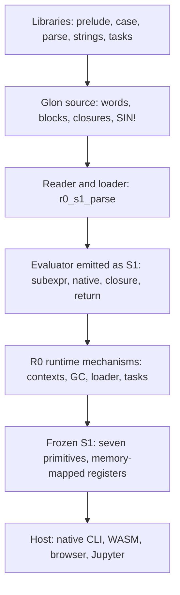

Language semantics live in the evaluator and the laws. Hosts move bytes and
present output; they do not implement evaluation. Library words are ordinary
Glon built from the core mechanisms.

---

## 2. Runtime state

The machine is one persistent, single-threaded 65,536-cell memory
configuration. The important logical state is:

| State | What it holds |
|---|---|
| Current context (`RV_CTX`) | The lexical environment used by word lookup |
| Child context (`RV_CHILD`) | The context of the activation being invoked |
| Current closure (`RV_CLOSURE`) | The closure being applied |
| Activation frame chain (`RV_FRAME`) | Linked frames for return and judges |
| Current block/cursor/end (`RV_BLK`, `RV_CUR`, `RV_END`) | The block being evaluated |
| Data stack | Tagged values and result sets |
| Return stack | Continuations, activation frames, stack-local contexts |
| Global context | 256-binding root environment |
| Managed heap | GC-managed blocks, strings, closures, contexts, SIN! |
| Loader heap | Permanent parsed source and symbols |
| Task table | Three cooperative task records |

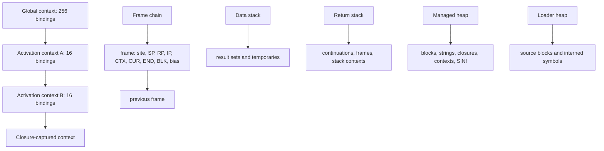

Contexts are a parent chain. Lookup walks from the current context toward the
global root. Frames are a separate chain used for return, judges, context
origin and the Guard of Binding.

---

## 3. Running a program

### 3.1 Host entry

A typical run:

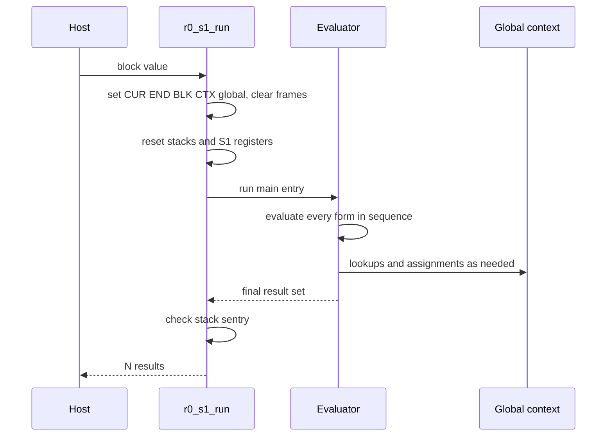

`r0_s1_run` is fresh-state; `r0_s1_run_persistent` preserves the managed heap
frontier so definitions survive across calls. Both reset the transient data
stack, return stack, frame chain and current context to the global context at
the start of each run (`r0_s1_runtime.c:4103-4158`).

### 3.2 Block sequence and result sets

Evaluating a block:

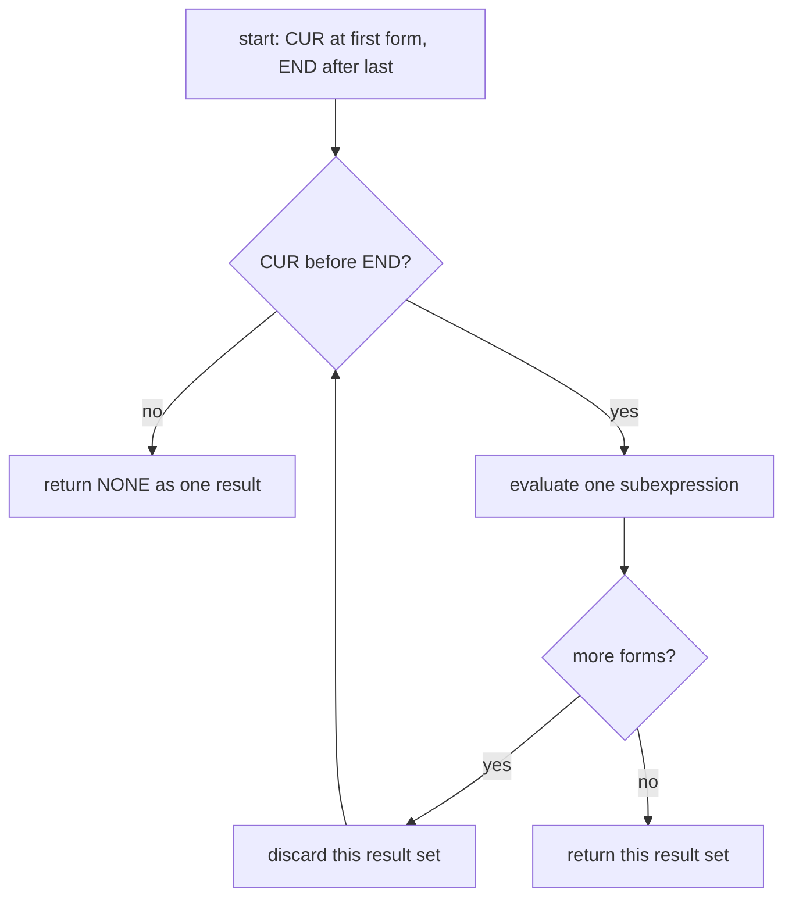

Each subexpression yields **zero or more results**. All but the last are
discarded by the block evaluator. The last result set is the block's result.
This is why `[1 2]` yields 2, while `[values [1 2]]` yields two results.

### 3.3 Result-set rules at call sites

Most operations collapse an argument expression to one value:

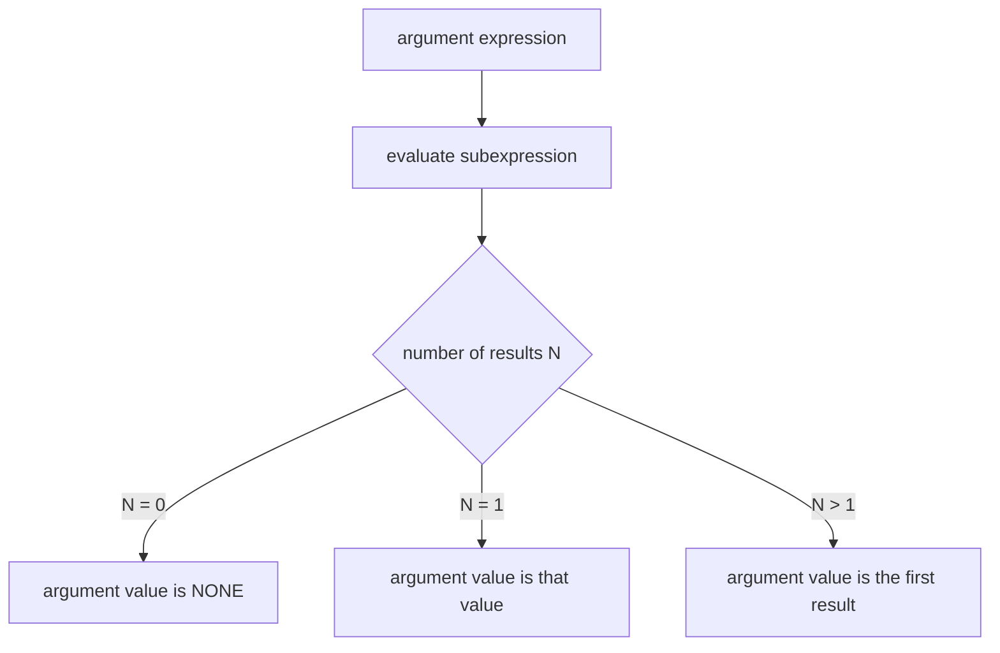

Consequences:

```glon
+ values [1 2] 3      ;; => 4  (first result 1, then 3)
reduce [values [1 2] 3] ;; => [1 3]
```

This collapse is IMPLEMENTED and is not stated in the Alpha laws. `values` is
the exception that preserves all results, but it requires each source form to
yield exactly one result.

---

## 4. Subexpression dispatch

Every form goes through `emit_subexpr` (`r0_s1_runtime.c:3569-3745`).

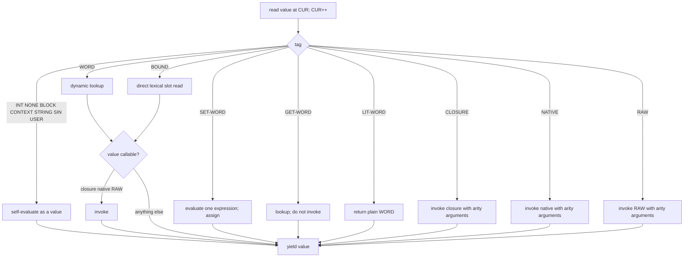

`func` and `return` are detected before ordinary WORD lookup, because they are
reserved keywords in value position. `masm`/`raw` are resolved by the reader,
not the evaluator.

---

## 5. Word resolution

### 5.1 Lookup

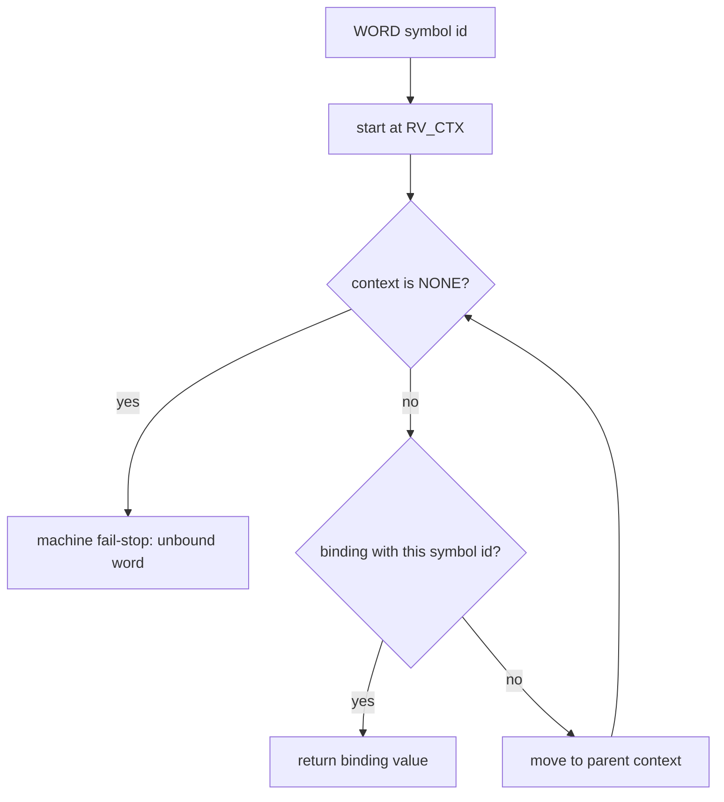

Lookup is dynamic through the lexical parent chain. It is not re-lexicalised.
A pre-resolved BOUND value skips the name search and reads `(depth, slot)`
directly, guarded by the frame site (`emit_load_lex`,
`r0_s1_runtime.c:2228-2291`).

### 5.2 Assignment

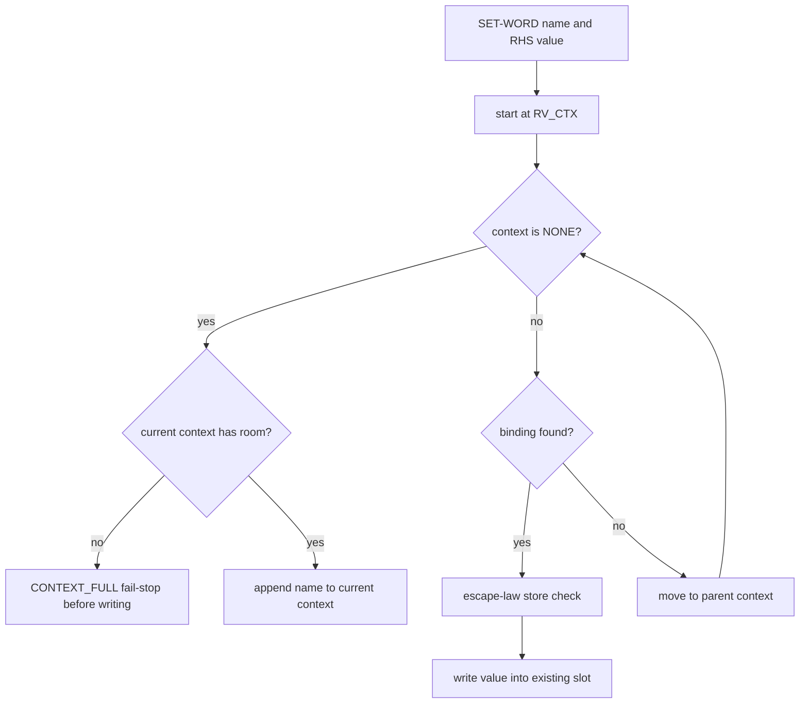

`r_set` (`r0_s1_runtime.c:2578-2643`) performs nearest-update. A local is
created only when the name exists nowhere in the chain. The `CONTEXT_FULL`
check occurs before any mutation.

### 5.3 Parameters and locals

On a closure call:

1. The caller evaluates all argument expressions left-to-right.
2. The evaluator creates a new child context under the closure's captured
   context.
3. It binds the spec's parameter words, in reverse spec order, into that
   context.
4. A set-word inside the body updates a parameter or an existing outer binding
   if present, otherwise it appends a local to the activation's 16-binding
   context.

The reverse-order bind is an implementation layout detail; programs see the
spec order.

---

## 6. Calls

### 6.1 Native and closure calls

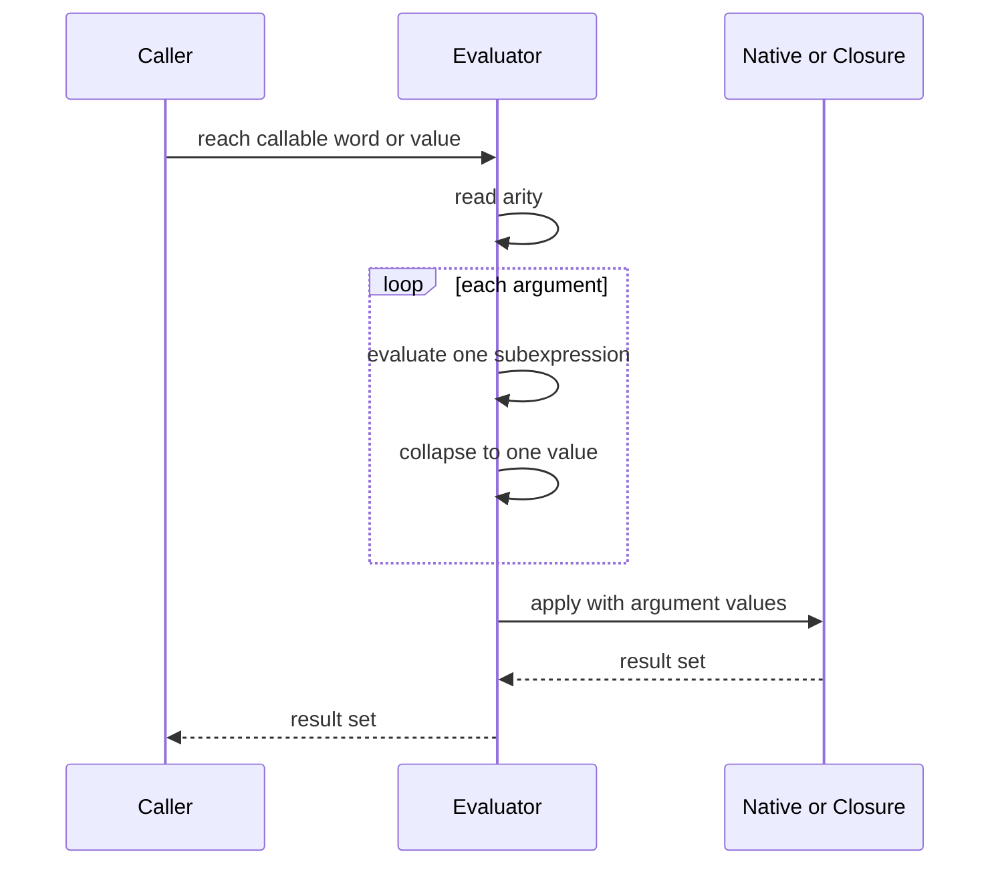

A plain word bound to a closure auto-invokes. `:f` retrieves the closure
without invoking it; `invoke :f` invokes it. `invoke` evaluates exactly one
expression to obtain a closure, then consumes the closure's arity from the
same caller expression stream.

### 6.2 Closure activation

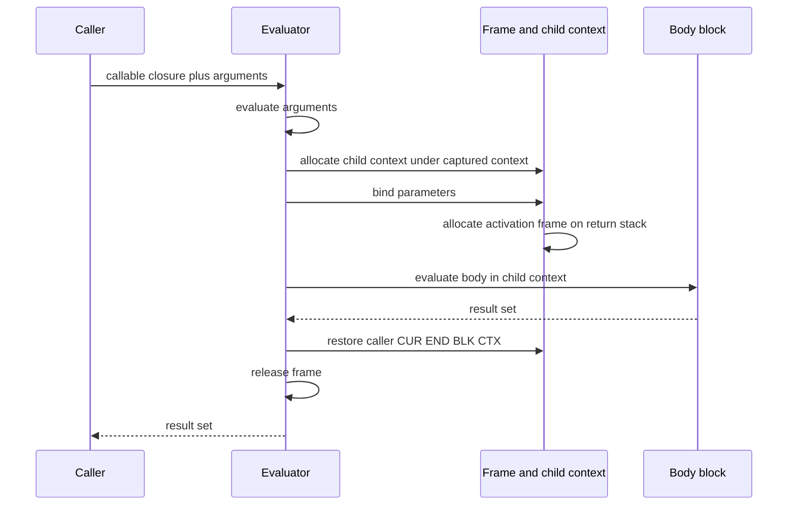

A normal closure return does not use `return`; it reaches the end of the body,
restores saved caller state from the frame, and continues after the call.
`return` is a separate non-local path (§7).

### 6.3 Capture and promotion

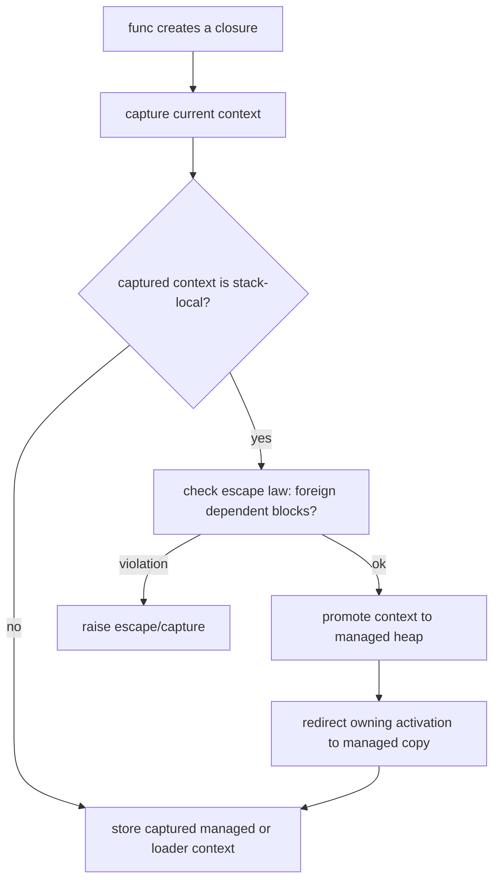

A closure always captures a context identity. Promotion means the activation
and its closures share one context, so mutation through either is visible to
both. A stack context that never escapes is reclaimed with its activation.

---

## 7. Non-local return

`return` reads the current block's site id, evaluates one expression, finds the
nearest live activation with that site, restores that activation's saved state
and jumps to its return address.

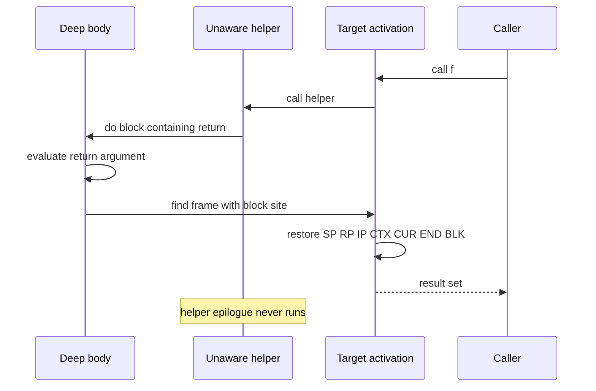

- `return` outside a function, or with no matching frame, is a machine
  fail-stop.
- A judge frame copies the enclosing site but is not an activation; `return`
  skips it and returns from the real function.
- A CASE action is a zero-argument closure, so `return` inside it returns from
  the action and CASE yields the value.

---

## 8. `do`, `values`, `reduce`, `either`

These operations differ in which block is executed and how results are kept.

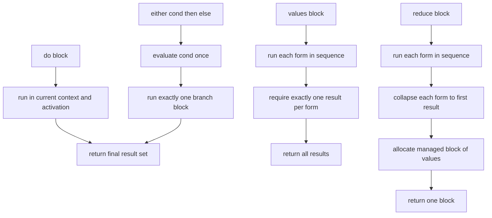

| Operation | Executes block? | Context | Result |
|---|---|---|---|
| `do` | yes | current | final result set |
| `either` | one branch | current | branch result set |
| `values` | yes, all forms | current | all results, one per form |
| `reduce` | yes, all forms | current | one managed block |
| `judge` | yes | current | result set or SIN! |
| bare block | no | — | the block value |

A managed block produced by `reduce` is data, not code. Executing it with
`do`, `values`, `reduce` or `judge` is a machine fail-stop.

---

## 9. SIN! propagation and `judge`

A SIN! is a value. `raise` is control flow.

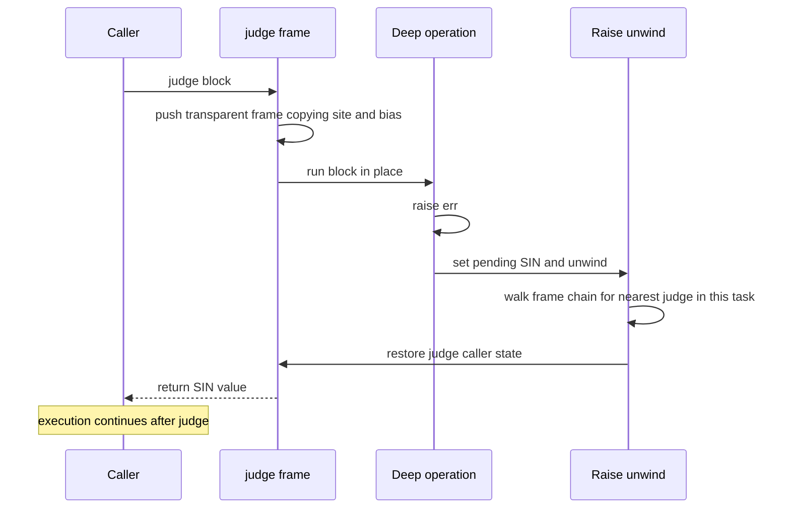

- The judge frame copies the enclosing activation's site and bias, so lexical
  references inside the judged block resolve as if the judge were not there.
- `return` inside a judged block unwinds through the judge to the enclosing
  function.
- A raise with no judge ends the run as an uncaught SIN!.
- Judges are per task. A task raise is caught only by a judge in that task.
- Machine-integrity failures are not SIN!s; no judge catches them.

---

## 10. Escape-time binding law

A block that depends on an activation may be used while that activation is
live, but may not escape it.

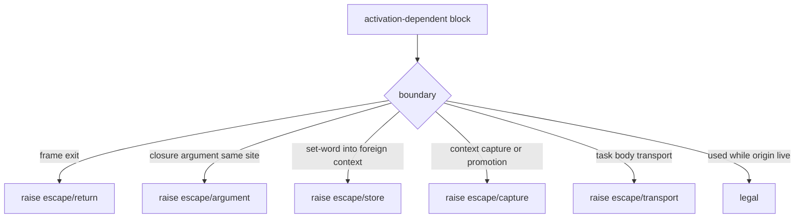

The check happens at the boundary, before the illegal value is stored,
returned, captured or transported. A judge receives the SIN!, never the
illegal block. A closure is the portable executable form; a bare bound block
is not.

---

## 11. Tasks

Tasks are cooperative and deterministic. There is no pre-emption and no
parallel execution.

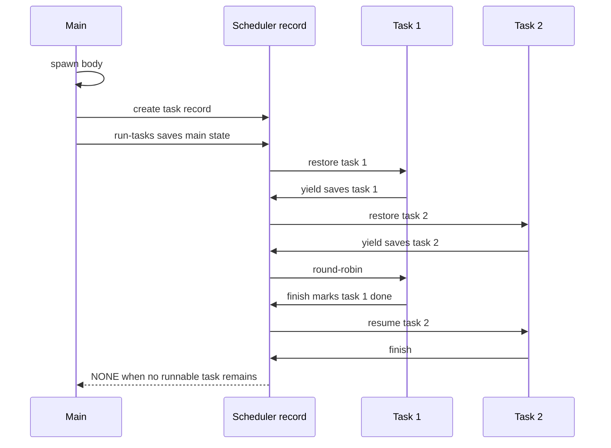

Each task record saves IP, SP, RP, CUR, END, CTX, BLK, FRAME and state. A task
runs only until `yield` or completion. A body that depends on the spawning
activation is rejected before the task table changes.

---

## 12. Worked traces

### 12.1 `+ 1 * 2 3`

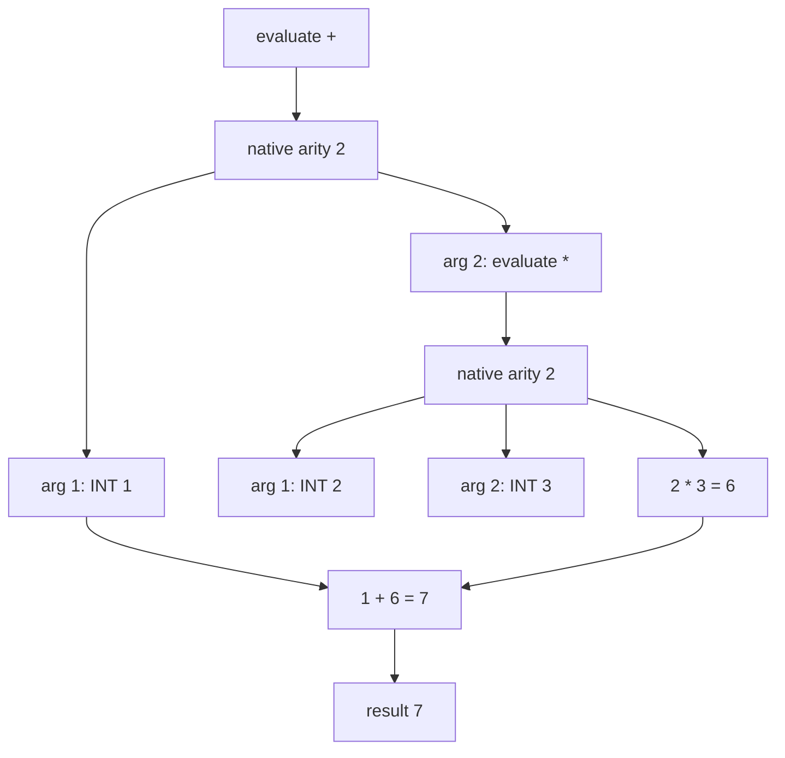

### 12.2 Factory closure

```glon
make-adder: func [n] [ func [x] [ + x n ] ]
add10: make-adder 10
add10 5
;; => 15
```

1. `make-adder` is called with `n = 10`; its child context holds `n`.
2. The body evaluates `func [x] [ + x n ]`, a literal body. The inner closure
   captures the `make-adder` activation's context and has bias 0.
3. The activation returns the closure. Its context is promoted to the managed
   heap because the closure escapes.
4. `add10 5` creates a new context for `x`, parented to the captured context.
5. `+ x n` reads `x` from the current context and `n` from the captured parent.

### 12.3 Mutable counter

```glon
counter: func [] [ n: 0  func [] [ n: + n 1 ] ]
c: counter
c c c
;; => 3
```

- `n: 0` has no existing binding, so it creates a local in the `counter`
  activation.
- The inner closure captures that context; it is promoted on return.
- Each call to `c` finds the existing `n` in the captured parent and updates it.
- This is one shared captured context, not a copy per call.

### 12.4 Non-local return through unaware code

```glon
helper: func [b] [ do b  99 ]
outer:  func [] [ helper [ return 42 ]  0 ]
outer
;; => 42
```

`return` inside the block sees the block's site (`outer`), evaluates 42, walks
the frame chain to `outer`, restores its state and returns. `helper` never
executes its `99` or its epilogue.

### 12.5 Judge

```glon
x: 1
e: judge [ raise create-sin 'demo 'oops 7 ]
x: + x 1
x
;; => 2
```

`judge` runs the block. `raise` unwinds to the judge frame, which returns the
SIN! as a value. The assignment after the judge runs normally.

---

## 13. State-change summary

| Operation | Affects |
|---|---|
| `name: value` | nearest binding, else current context |
| Parameter bind | new activation context |
| Closure creation | captures a context; may promote it |
| `do` | no new context; executes in current |
| `either` | no new context; executes one branch block |
| `judge` | adds a transparent frame; catches raises |
| Function call | new context, frame, return-stack reservation |
| `return` | unwinds to the matching function frame |
| `raise` | unwinds to the nearest judge in the same task |
| `reduce` | allocates one managed block |
| `values` | does not allocate a result block itself |
| `s/+` etc. | allocate a new managed string |
| `spawn` | creates one task record if the body passes the transport check |
| GC | reclaims unreachable managed objects; loader heap is permanent |
