# Glon Syntax Diagrams

This file diagrams the grammar the current reader actually implements. It is
descriptive: `GLON-ALPHA-LAWS.md` is normative and the reader is the ground
truth for lexical detail. The productions and diagrams were verified against
the reader in `GLON-SPEC-VERIFICATION.md` §3–§4. See
`GLON-LANGUAGE-SPEC.md` §1 for prose.

## Notation

- `[` and `]` in a diagram are literal Glon brackets; `{ ... }` means
  repetition; `?` means optional.
- The reader has no comment syntax. A host strips `;;` comments before the
  reader sees them.
- Whitespace separates forms. There is no parenthesis, comma, escape or
  comment grammar.
- `form` means a complete expression as the evaluator sees it. Argument
  grouping is decided at run time by callee arity, not by punctuation.

---

## 1. Source envelope

The canonical host form is one outer block. The bare parser also accepts an
unwrapped top-level sequence.

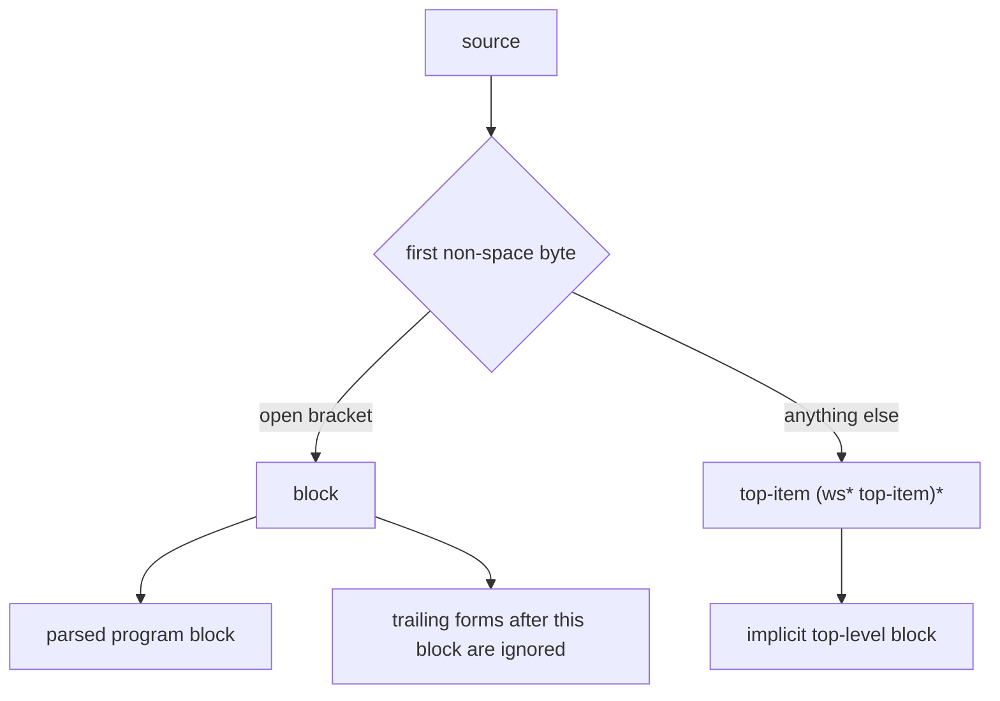

The trailing-forms behaviour is an implementation quirk of `parse_program`
(`r0_s1_runtime.c:3963-4002`). Canonical hosts wrap source as `[ ... ]`, so
the whole cell is one block.

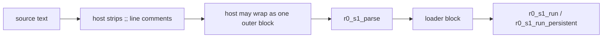

---

## 2. Item and form alternatives

The block/program loop recognises items. Only `parse_form` recognises the
basic forms.

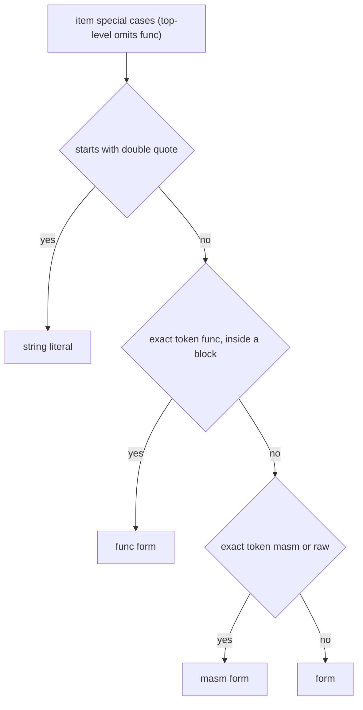

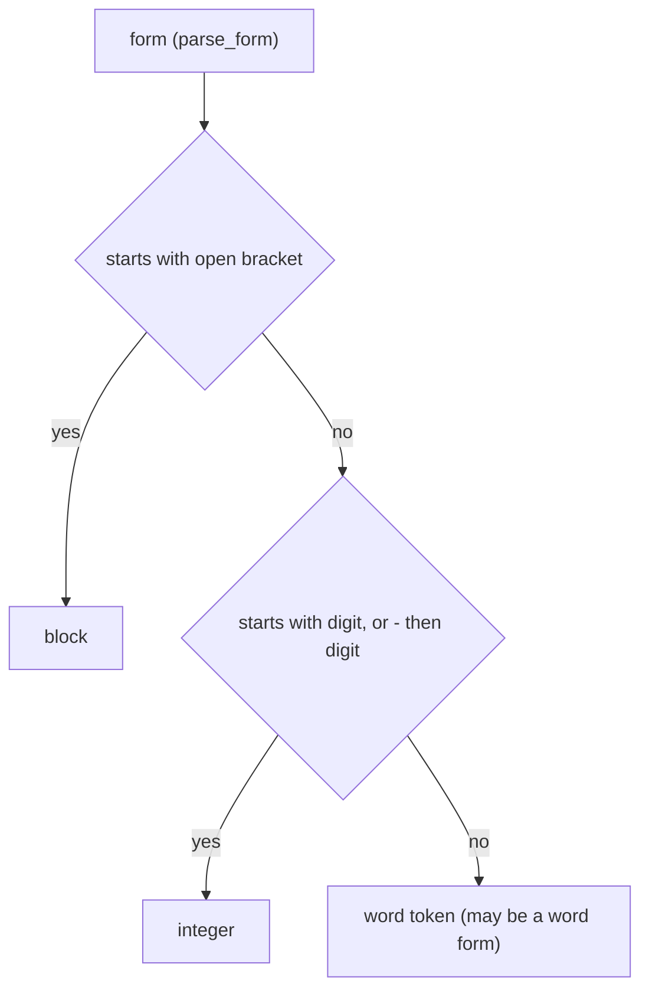

The `func`, `masm` and `raw` tests happen before ordinary word parsing in
`parse_block` (`r0_s1_runtime.c:764-886`). `parse_program` recognises
`masm`/`raw` but **not** `func`; an unwrapped top-level `func` is an ordinary
word. A string at `form` position (for example a `func` spec) is a word token,
not a string literal.

---

## 3. Block

A block is a bracket-delimited sequence. Empty blocks are legal. Each string
literal expands to two forms.

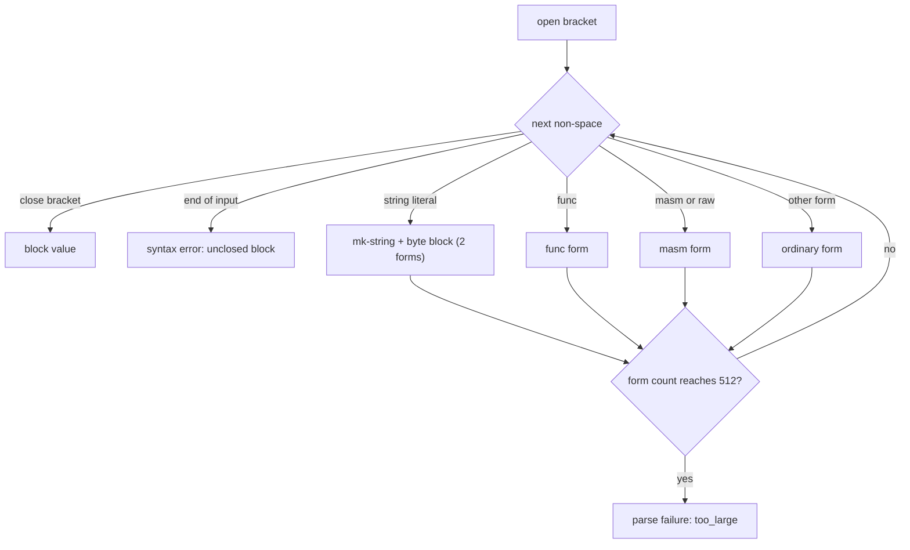

Form limit is 512 (`r0_s1_runtime.c:780`, `872`). A quoted string contributes
two forms even when empty.

---

## 4. Word token and word forms

The reader takes the longest run of non-whitespace bytes that excludes `[` and
`]`, truncates it to 63 bytes, then applies the first matching rule.

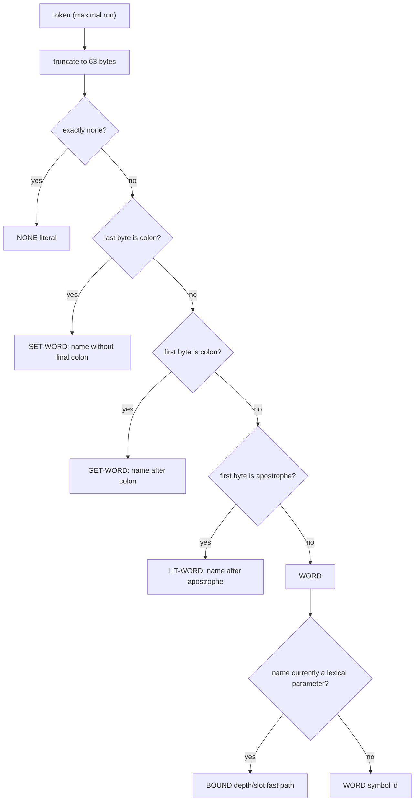

Order matters. `'x:` is a SET-WORD (trailing colon wins) whose name is `'x`.
`none` is the only special token; `none:`, `:none` and `'none` are word forms.

Evaluation of word forms:

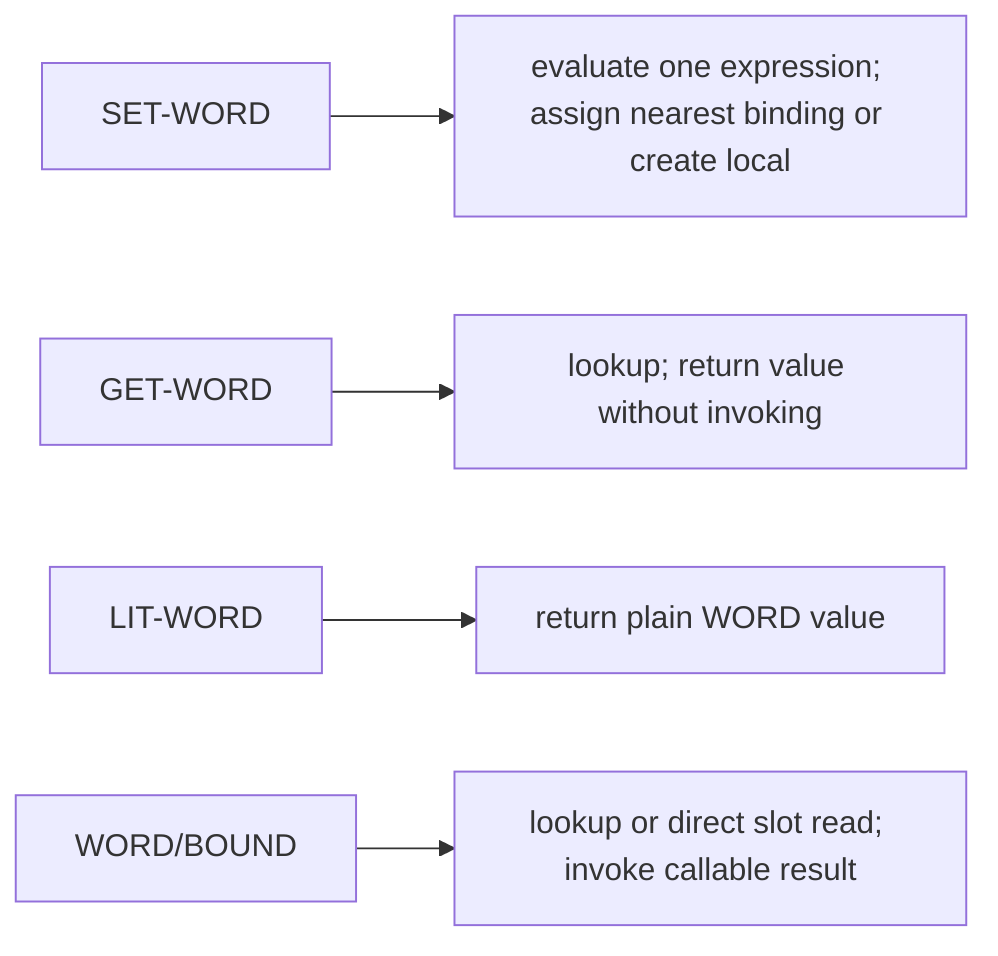

---

## 5. Integer

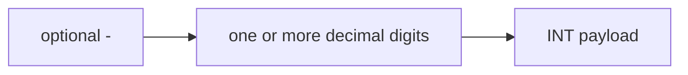

No `+` sign, no decimal point, no exponent, no hex, no underscores.

---

## 6. String literal

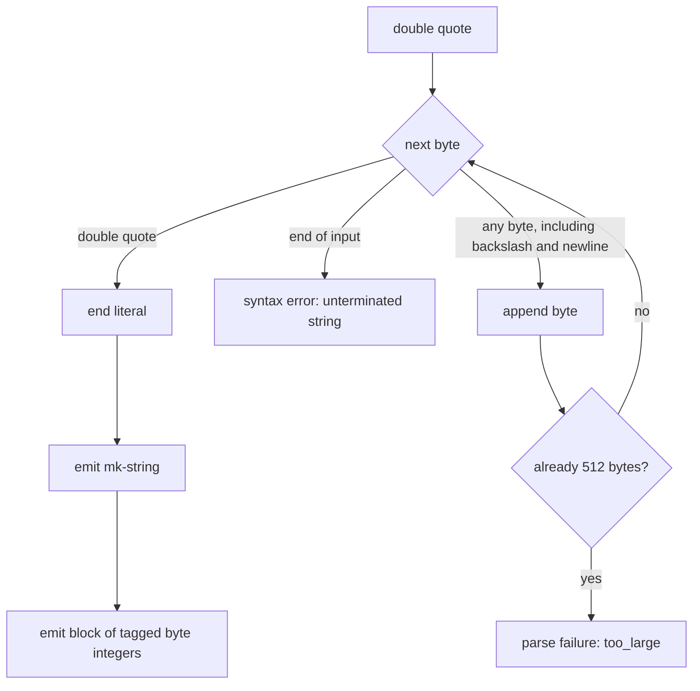

There is no escape syntax: `"` always ends the literal. The expansion is
`mk-string [b0 b1 ...]`, so the literal costs two forms and needs a
`mk-string` binding at run time.

---

## 7. `func` form

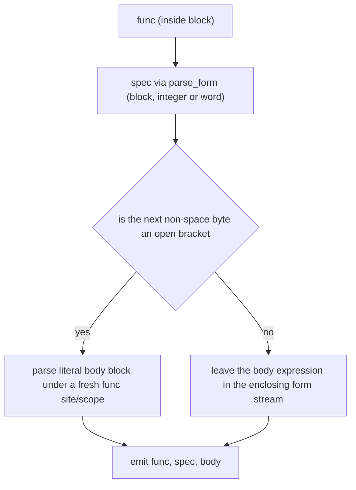

This `func` special case applies only inside a block. In an unwrapped
top-level source the word `func` is not special-cased. At run time `func`
evaluates the spec expression and the body expression. The body must evaluate
to a block. The spec block's element count is the arity.
Literal and computed bodies have different lexical capture rules
(`GLON-LANGUAGE-SPEC.md` §3.5).

---

## 8. `masm` / `raw` form

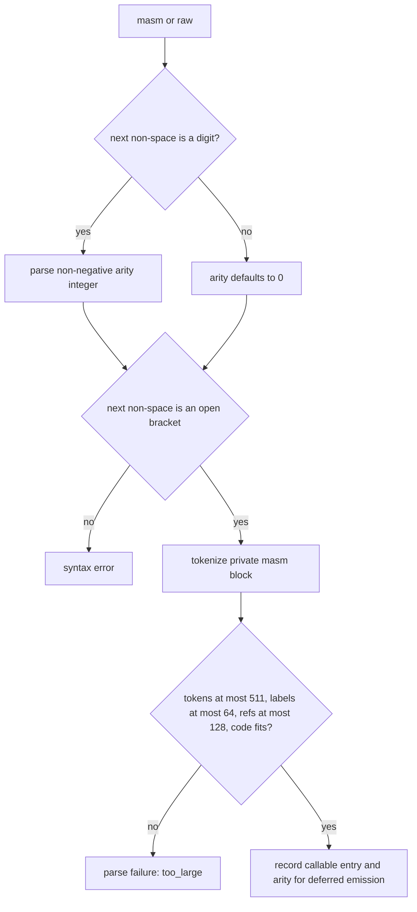

The `masm`/`raw` keyword must be the whole maximal token; `masm1` is an
ordinary word. The optional arity is recognised only as a non-negative decimal
integer after whitespace. The masm block is not Glon. Its mnemonics, operands
and labels are not interned and do not participate in Glon binding. The callable is a RAW value
with layout `[entry, arity]`.

---

## 9. Evaluation grouping (arity grammar)

There is no lexical grammar for grouping. The evaluator's arity determines
which following forms belong to a call.

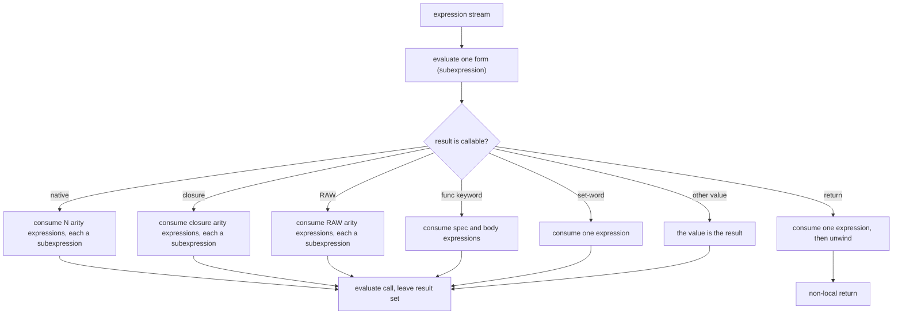

Examples:

```glon
+ 1 * 2 3          ;; + 1 (* 2 3)      => 7
double double 5    ;; double (double 5)
f 1 2              ;; f consumes two expressions
values [10 20]     ;; one expression yielding two results
```

---

## 10. Parse trees for representative sources

```text
x: 5
+ x 3
```

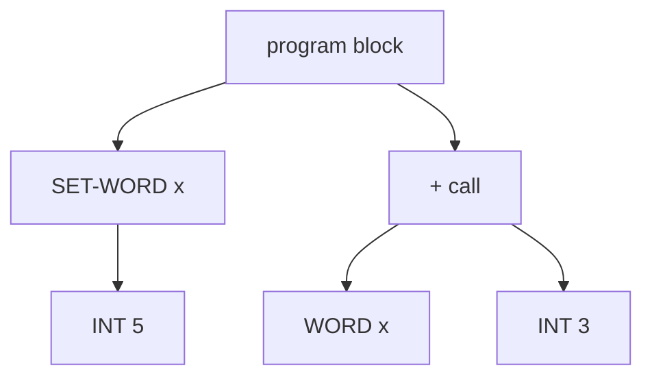

```text
double: func [x] [ * x 2 ]
double 21
```

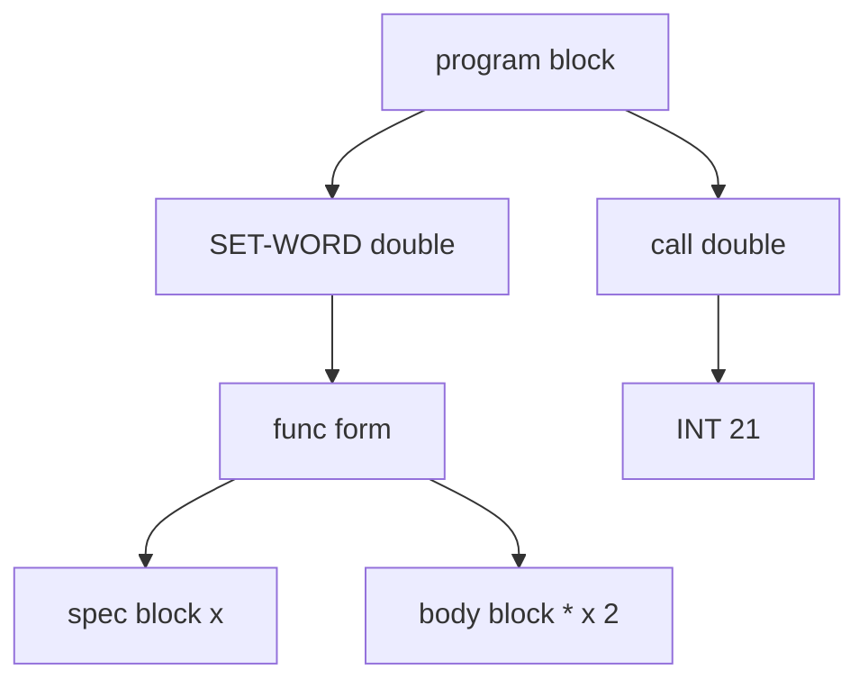

```text
case [ [< n 10] [ 'small ] [1] [ 'large ] ]
```

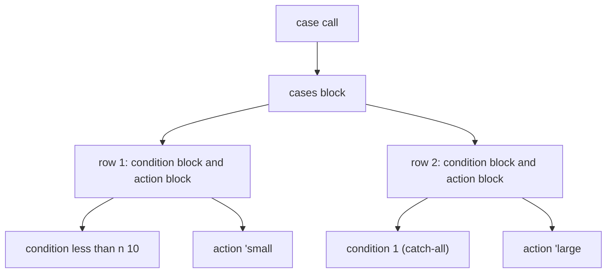

`case` is ordinary library code. Its clauses are data blocks; it turns them
into zero-argument closures at run time.

---

## 11. Consolidated EBNF

```ebnf
source         = ws* ( block trailing-tail | top-item ( ws* top-item )* ws* ) ;
trailing-tail  = any-byte* ;              (* ignored after a leading block *)
top-item       = string | masm-form | form ;
block          = "[" ( ws | block-item )* "]" ;
block-item     = string | func-form | masm-form | form ;
form           = block | integer | word ;
func-form      = "func" form block? ;     (* body may be left to the next item *)
masm-form      = ( "masm" | "raw" ) ( ws+ digit+ )? ws* masm-block ;
masm-block     = "[" masm-tokens "]" ;
string         = '"' non-quote-byte* '"' ;          (* item-start only; 0..512 bytes *)
integer        = [ "-" ] digit+ ;
word           = token ;
word-value     = "none" | token ":" | ":" token | "'" token | token ;
token          = token-byte+ ;            (* reader keeps the first 63 bytes *)
token-byte     = ? any byte except whitespace, "[" or "]" ? ;
non-quote-byte = ? any byte except double quote ? ;
any-byte       = ? any byte 0..255 ? ;
masm-tokens    = ? private S1 macro-assembly tokens ? ;
digit          = "0" | "1" | "2" | "3" | "4" | "5" | "6" | "7" | "8" | "9" ;
ws             = " " | "\t" | "\n" | "\r" | "\v" | "\f" ;
```

Keyword alternatives apply only when the whole maximal token is exactly
`func`, `masm` or `raw`; `funcx` is a word. `func` is special-cased by
`parse_block`, not by `parse_program`, so an unwrapped top-level `func` is an
ordinary word. A quote at item start is a string; a quote inside `form`
(spec/body position) is part of a word token. The EBNF describes lexical
acceptance only. It does not describe arity grouping, function capture, result
sets or failure behaviour; those are in `GLON-EVALUATION-MODEL.md` and
`GLON-LANGUAGE-SPEC.md`.

---

## 12. Implemented lexical quirks worth remembering

| Quirk | Effect |
|---|---|
| Token truncation at 63 bytes | two long names can intern to one symbol |
| `[` first in source | only that block is parsed; trailing forms ignored |
| Unwrapped top-level `func` | `parse_program` does not assign a fresh func site/lexical scope; canonical hosts wrap source in one block |
| `;;` stripped by host, not reader | `;;` inside a string is also removed |
| String literal expands to `mk-string [...]` | needs library/prelude binding; costs 2 forms |
| No escapes | `"` cannot appear inside a string |
| `none` is a literal token | `none:` does not affect plain `none` |
| Trailing colon wins | `'x:` is a set-word named `'x` |
| No parentheses | grouping is entirely arity-driven |
| Single `;` is ordinary | only doubled `;;` is a host comment |


---

## 13. Diagram-to-EBNF map

| Diagram | EBNF production | Accuracy notes |
|---|---|---|
| §1 Source envelope | `source`, `trailing-tail` | A leading block ignores all trailing bytes; an unwrapped source is a sequence of top-items. |
| §2 Item alternatives | `top-item`, `block-item` | `func` is an item only inside a block; top-level `func` is a word. |
| §2 Form alternatives | `form` | `parse_form` accepts block, integer or word only; no string, `func` or `masm` special case. |
| §3 Block | `block`, `block-item` | Empty blocks accepted; 512-form limit; a string contributes two forms. |
| §4 Word forms | `word`, `token`, `word-value` | Token is maximal and truncated to 63 bytes before the first-match word rules. |
| §5 Integer | `integer` | Optional `-`, decimal digits only. |
| §6 String | `string` | Item-start only; no escapes; 512-byte limit; expands to `mk-string` plus a byte block. |
| §7 Func | `func-form` | Only inside a block; optional literal body block; computed body left in the stream. |
| §8 Masm | `masm-form` | Exact keyword token; optional non-negative arity; private masm block. |
| §9 Grouping | none | Grouping is an evaluation rule, not a lexical production. |
